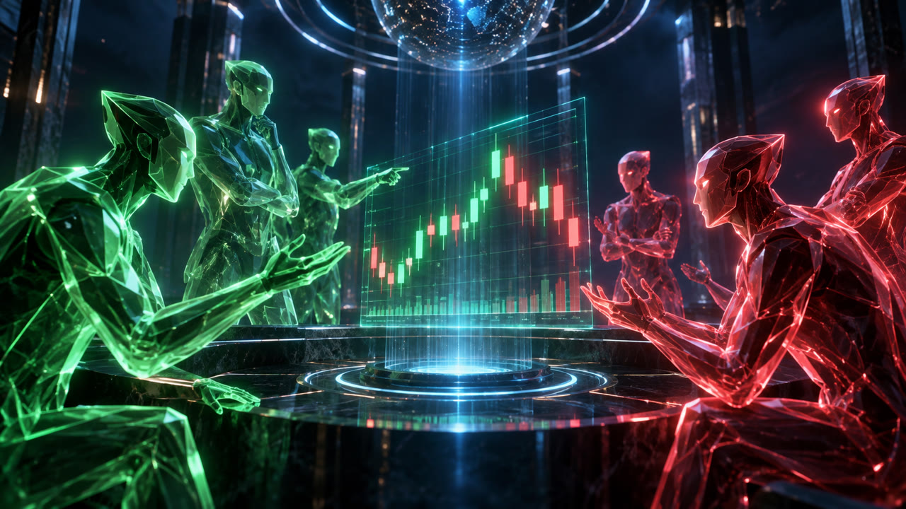

# ⚡ OMNI DAYT

### Um time de agentes de IA que vigia o mercado, debate cada entrada a favor e contra, e só opera dentro de regras de risco inegociáveis.

**Demo primeiro, sempre.** Projeto pessoal · novembro de 2026 · Brasil 🇧🇷

---

## 🧠 O que é

O Omni DayT é um sistema autônomo de day trade com uma arquitetura diferente de tudo que é robô de trading comum: em vez de seguir um script fixo, ele coloca **agentes de IA para discordarem entre si**. Cada oportunidade precisa sobreviver a um funil impiedoso - filtro numérico, portões de segurança, debate entre agentes a favor e contra, e um gerente de risco com poder de veto absoluto.

Nenhuma entrada acontece por impulso. Nenhuma regra de risco é negociável. E tudo começa onde deveria: **em conta demo, com registro de cada passo.**

## 🌪️ Por que existe

| | |
| --- | --- |
| **O mercado não espera você acordar** | Cripto não fecha. Milhares de candles se formam enquanto você trabalha, dorme e vive. |
| **Emoção quebra disciplina** | Medo e ganância entram na decisão. Regra escrita e executada por código não sente nada. |
| **Ninguém vê tudo** | Um humano não acompanha vários ativos, indicadores e notícias ao mesmo tempo. Máquinas veem. |

## ⚙️ Como funciona

O ciclo de operação, ponta a ponta:

1. **Coleta contínua** - ticks, candles e notícias chegam sem parar, direto da fonte, por código.
2. **Filtro numérico** - indicadores e previsão de séries temporais descartam a maioria dos ativos, sem gastar IA.
3. **Portões** - payout mínimo, janela de notícia forte, limites do dia. O que não passa, nem vira candidato.
4. **Debate** - agentes de IA a favor e contra justificam o candidato com dados.
5. **Decisão** - votos ponderados pelo placar de acerto de cada agente.
6. **Risco** - o gerente valida valor e limites. Pode vetar qualquer decisão.
7. **Execução** - ordem por API, com preço e horário exatos registrados.
8. **Aprendizado** - o resultado entra no journal e atualiza os placares. O sistema aprende com o próprio histórico.

## 🥊 Um time de agentes que discorda de propósito

- Um agente **defende** a entrada; outro **ataca**. Os dois com dados, nunca com opinião.
- **Placar de acerto:** o voto de quem acerta mais pesa mais. Ninguém é excluído.
- **Peso por cenário:** cada agente atua onde é forte - tendência, lateral, notícia.
- **Modo sombra:** agente novo entra só registrando o que faria, até provar valor.

## 📊 Dois anos de mercado como professor

- Coletor próprio grava **cada tick** desde o dia 1.
- Candles públicos de minuto a minuto cobrem anos de mercado, de graça.
- O histórico vira **estatística**: regimes, horários fortes e situações parecidas com a de agora.
- Os agentes recebem o resumo **em números**, não o gráfico inteiro.

> **Honestidade técnica:** índices sintéticos são gerados aleatoriamente pela própria corretora - histórico longo não ensina padrão neles. O foco do projeto é mercado real.

## 🛠️ Ferramentas

| Camada | Ferramentas |
| --- | --- |
| Motor | Python assíncrono · FastAPI |
| Dados e execução | Deriv API (WebSocket oficial) · ccxt |
| Análise numérica | pandas-ta · TimesFM (previsão de séries temporais do Google, em CPU) |
| Memória | SQLite com journal completo |
| Painel | Next.js como PWA, direto no celular |
| Alertas | WhatsApp |
| Hospedagem | Render |
| Construção | Agentes de IA de código (Claude Code, Codex) sob direção e revisão humana, módulo por módulo, com suíte de testes própria |

## 🌐 Projetos open source em que nos apoiamos

O Omni DayT existe de pé sobre projetos abertos. Nada deles é distribuído aqui - só crédito e link.

**Uso ativo no motor**

- [Deriv API](https://developers.deriv.com) (Deriv, termos da Deriv) - dados de mercado e execução de ordens por WebSocket oficial.
- [ccxt](https://github.com/ccxt/ccxt) (MIT) - padroniza dados e ordens em exchanges de cripto.
- [pandas-ta](https://github.com/twopirllc/pandas-ta) (twopirllc, MIT) - indicadores técnicos de análise.
- [TimesFM](https://github.com/google-research/timesfm) (Google Research, código Apache-2.0) - previsão de séries temporais em CPU, em versão permitida para uso pessoal e demo.
- [Chronos-2](https://github.com/amazon-science/chronos-forecasting) (Amazon Science, Apache-2.0) - alternativa aberta de previsão de séries.

**Inspiração de arquitetura (estudados e adaptados, com link, sem copiar código)**

- [ai-hedge-fund](https://github.com/virattt/ai-hedge-fund) (virattt, MIT) - time de agentes de IA com gestor de risco; modelo conceitual do nosso debate a favor e contra.
- [TradingAgents](https://github.com/TauricResearch/TradingAgents) (Tauric Research, Apache-2.0) - agentes em papéis (analista, pesquisador, trader, risco); referência para a organização do time.
- [day-trader-skill](https://github.com/jakeschincariol/day-trader-skill) (Jake Schincariol, MIT) - vocabulário e checklists de day trade para agentes; parte do conteúdo virou regra interna dos nossos agentes.
- [FinRL](https://github.com/AI4Finance-Foundation/FinRL) e [FinGPT](https://github.com/AI4Finance-Foundation/FinGPT) (AI4Finance Foundation, MIT) - aprendizado por reforço e LLMs financeiros; referência para experimentos futuros.

**Somente referência (licença copyleft ou restrita: nunca copiados nem importados no motor)**

- [backtesting.py](https://github.com/kernc/backtesting.py) (kernc, AGPL-3.0) - backtest local sobre dados próprios; ferramenta separada de pesquisa.
- [MiroFish](https://github.com/666ghj/MiroFish) (666ghj, AGPL-3.0) - simulação de enxames para prever cenários; estudo ocasional antes de eventos grandes.
- [Freqtrade](https://github.com/freqtrade/freqtrade) (GPL-3.0) - bot de trading open source; referência de arquitetura.
- [vectorbt](https://github.com/polakowo/vectorbt) (polakowo, licença própria com restrições) - backtest vetorizado, só pesquisa local.

## 🛡️ As regras que ninguém quebra

- Limite duro de valor por entrada e de perda máxima diária: bateu, o motor **para sozinho**.
- Sequência de perdas no limite: **pausa automática**.
- **Martingale: nunca, em nenhuma hipótese.**
- Bloqueio automático em janela de notícia forte.
- **Botão de parada de emergência**, com alerta imediato no WhatsApp.
- Mudar limite depois de perdas passa por um lembrete de reflexão. A decisão final é sempre humana, escrita antes do modo autônomo ligar.

## 🔬 Prova antes de dinheiro

- **Centenas de operações em demo** antes de qualquer conclusão.
- **Intervalo de confiança:** acertar muito em poucas operações pode ser sorte, não vantagem.
- Parte dos dados fica **separada e intocada** até o teste final (holdout).
- O placar é comparado contra um **robô aleatório**: é preciso ganhar dele com folga.
- Se não superar o ponto de equilíbrio, **paramos e reavaliamos**.

> Perder pouco e aprender rápido também é vitória.

## 🗺️ Status e roadmap

**Onde estamos:** o motor está construído - coletor, histórico, indicadores, filtros, estatísticas, backtest realista, debate de IA, gerente de risco, executor, orquestrador, painel PWA e monitoramento de saúde - com suíte de testes automatizados passando. O próximo passo é o primeiro teste ao vivo em conta demo.

**Autonomia em degraus:**

`1 · Observar` → `2 · Sugerir` → `3 · Autônomo na demo` → `4 · Real: só com provas e OK explícito`

## 🚫 O que este projeto não é

- **Não é promessa de lucro.** Nenhum número de retorno aparece aqui porque nenhum existe ainda.
- **Não é um modelo pronto.** Não existe IA treinada que acerte direção em minutos. A vantagem, se houver, será provada em backtest e demo.
- **Não se apoia em índices sintéticos.** Eles são gerados aleatoriamente; histórico deles não ensina padrão.
- **Não ignora a parte legal.** Nenhuma corretora de opções binárias tem autorização da CVM; não há proteção ao investidor. Por isso: demo primeiro.
- **Não é produto comercial.** É um projeto pessoal de pesquisa e engenharia, construído em público como vitrine.

## ⚠️ Aviso legal

Opções binárias envolvem risco alto e não contam com corretoras autorizadas pela CVM no Brasil. Este projeto é educacional e experimental, opera apenas em **conta demo** e **não é recomendação de investimento**.

## 📁 Sobre este repositório

Este repositório é a **vitrine pública** do Omni DayT: visão, conceito, método e bastidores. O código, os dados e as configurações ficam em repositório privado - aqui não há o que baixar nem passo a passo de construção. Acompanhar a evolução é só olhar.

## 👤 Autor

**Fábio Henrique Correa** - idealização, direção de produto e todas as decisões de risco.
Construção assistida por agentes de IA de código, módulo a módulo, com testes definidos antes da implementação.

### Demo primeiro. Prova sempre.

---

## 🇺🇸 English (short version)

**Omni DayT** is a personal, demo-first research project: an autonomous day-trading engine where **AI agents debate every trade for and against**, a numeric funnel filters candidates before any AI is spent, and a **risk manager holds absolute veto power** - hard loss limits, no martingale, news-window lockouts, and an emergency stop. It collects its own tick data, learns from its own journal, backtests against a random baseline with untouched holdout data, and only earns more autonomy in steps: observe, suggest, autonomous on demo, and real money only with proven results and explicit approval. Built module by module with AI coding agents under human direction, with its own automated test suite. This repository is a **public showcase only** - no code, no data, no build instructions, and no profit promises.
